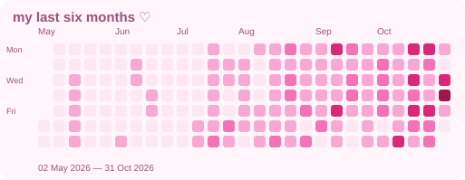

  
  

  <i>୨୧ building things with code, curiosity & creativity ୨୧</i>
   
  istanbul, türkiye
    
  <a href="https://portfolio-b7d255.webflow.io">♡ portfolio</a>
  &nbsp; ✿ &nbsp;
  <a href="https://linkedin.com/in/idil-d-8472b5253">linkedin</a>
  &nbsp; ✿ &nbsp;
  <a href="mailto:idildoga4@hotmail.com">say hello</a>

 

<table>
<tr>
<td width="50%" bgcolor="#FFF0F6" align="center">

### 🌷 currently building

Flutter applications

TypeScript · Node.js

Full-stack products

</td>
<td width="50%" bgcolor="#F4ECFA" align="center">

### 🧸 currently exploring

Swift · Electronics

Hardware projects

Learning by building ♡

</td>
</tr>
</table>

 

### 🎀 a little about me

I'm a software engineer who loves building useful things and exploring how technology works under the hood.

- ♡ **Mobile:** Flutter & Dart
- ♡ **Full-stack:** TypeScript & Node.js
- ♡ **Systems:** C & C++
- ♡ **Workflow:** Docker, CI/CD & testing
- ♡ **On my learning list:** Swift & hardware

---

### 🧁 my toolbox

<table>
<tr>
<td bgcolor="#FFF4F8" width="150"><b>mobile</b></td>
<td>Flutter · Dart</td>
</tr>
<tr>
<td bgcolor="#FFF4F8"><b>full-stack</b></td>
<td>TypeScript · Node.js</td>
</tr>
<tr>
<td bgcolor="#FFF4F8"><b>systems</b></td>
<td>C · C++</td>
</tr>
<tr>
<td bgcolor="#FFF4F8"><b>workflow</b></td>
<td>Git · Docker · CI/CD · Testing</td>
</tr>
<tr>
<td bgcolor="#FFF4F8"><b>exploring</b></td>
<td>Swift · Electronics · Hardware</td>
</tr>
</table>

---

  

